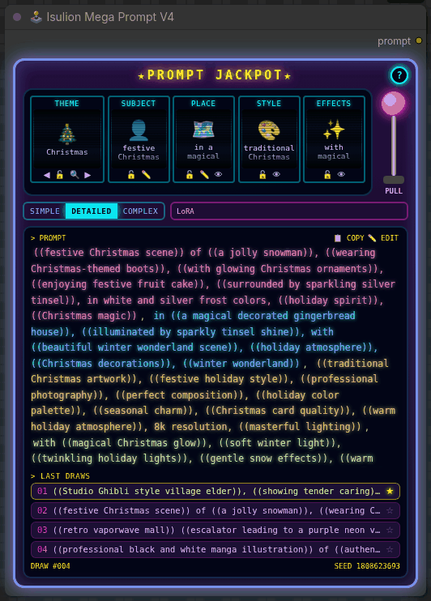
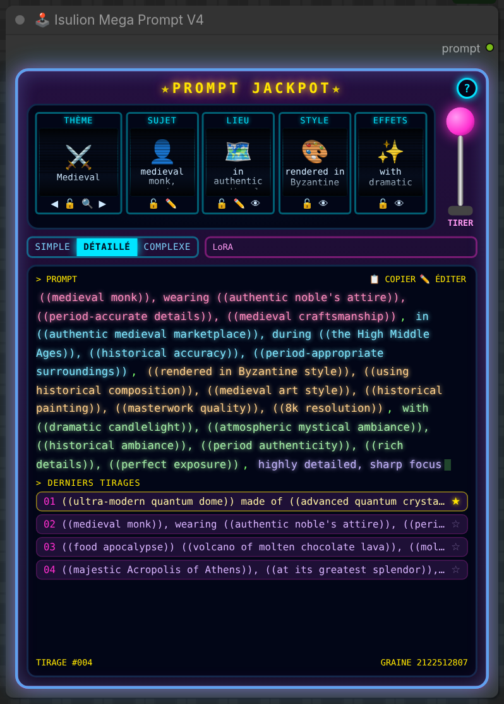
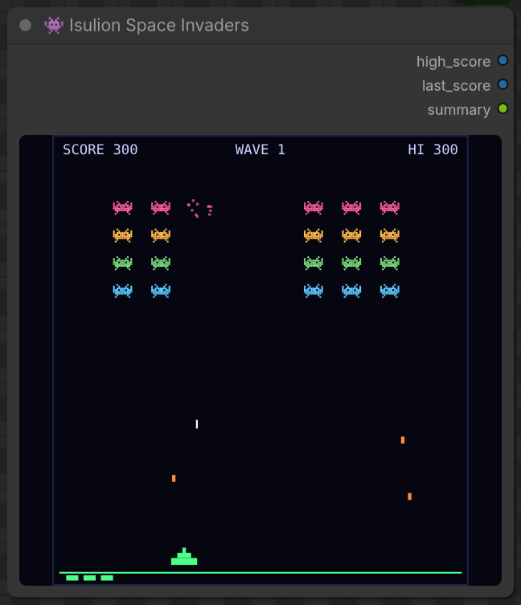

<p align="right"><a href="README.md">English</a> · <b>Français</b></p>

# ComfyUI_Isulion

**Tire le levier, récupère un prompt.** Un pack de nodes ComfyUI construit autour des générateurs Mega Prompt : 109 thèmes faits main, une machine à sous d'arcade qui écrit tes prompts, et une série de petits générateurs et d'outils d'image pour les accompagner.

<p align="center">
  
</p>

## Installation

**ComfyUI Manager (recommandé) :** ouvre le **Custom Nodes Manager**, cherche **Isulion** et installe.

**Installation manuelle :**

```bash
cd ton_dossier_ComfyUI/custom_nodes
git clone https://github.com/Isulion/ComfyUI_Isulion
```

Redémarre ComfyUI, puis recharge la page du navigateur. La seule dépendance Python supplémentaire est `requests` (voir `requirements.txt`) ; tout le reste est fourni par ComfyUI.

--------------

## Nodes interactifs

Ces deux nodes dessinent leur propre interface à l'intérieur du node (leur code navigateur est dans `web/`).

### 🕹️ Isulion Mega Prompt V4 — « Prompt Jackpot »

Une machine à sous qui écrit ton prompt. Cinq rouleaux tirent chacun un morceau du prompt dans les thèmes Isulion, et le node n'a qu'une sortie : `prompt`.

<p align="center">
  
</p>

**Mode d'emploi**

1. Ajoute **🕹️ Isulion Mega Prompt V4** (catégorie `Isulion/Core`) et branche `prompt` sur ton encodeur de texte (par exemple `CLIPTextEncode`).
2. Tire le levier **TIRER** pour voir des tirages dans le navigateur, sans lancer le workflow.
3. Lance le workflow : la machine retourne à chaque exécution, et l'écran affiche exactement le prompt envoyé.

| Commande | Effet |
|---|---|
| **Rouleaux** | THÈME (◀ ▶ pour faire défiler, 🔍 pour chercher parmi les 109 thèmes), SUJET, LIEU, STYLE, EFFETS |
| 🔒 **Verrou** | Un rouleau verrouillé ne bouge plus, ni avec le levier ni à l'exécution. Choisir un thème le verrouille ; laisse-le libre pour un thème au hasard à chaque fois. |
| ✏️ **Ton texte** | Sur SUJET et LIEU : ton texte reste à chaque tirage et le thème reconstruit la formulation autour. ✕ l'efface. |
| 👁 / 🚫 **Allumer, éteindre** | LIEU, STYLE et EFFETS peuvent être éteints : ils passent en gris et sortent du prompt. |
| **SIMPLE / DÉTAILLÉ / COMPLEXE** | Sans formules de qualité, avec quelques mots de détail, ou avec un bloc plus riche (composition, textures, lumière). |
| **LoRA** | Texte fixe toujours ajouté à la fin, par exemple un mot déclencheur ou `<lora:nom:0.8>`. |
| **Écran PROMPT** | Chaque rouleau a sa couleur. Clique un morceau pour relancer seulement ce rouleau. **COPIER** copie le prompt ; **ÉDITER** fige un prompt écrit à la main, envoyé tel quel à chaque exécution jusqu'au prochain coup de levier. |
| **Derniers tirages** | Les 5 derniers tirages. Clique une ligne pour la recharger ; ☆ la garde en favori, en tête de liste. Le pied de l'écran affiche le compteur de tirages et la graine. |
| **?** | Aide intégrée en anglais ou en français ; la langue choisie est mémorisée. |

L'état de la machine (thème, verrous, tes textes, complexité, LoRA) est enregistré avec le workflow. **La Mega Prompt V3 reste disponible, inchangée**, pour les workflows existants.

### 👾 Isulion Space Invaders

Un petit Space Invaders jouable dans le node, pour patienter pendant que la file tourne.

<p align="center">
  
</p>

- Clique sur le jeu pour lui donner le focus, puis **Entrée** ou **Espace** pour commencer (**Entrée** pour rejouer après un game over).
- **← →** ou **A D** pour se déplacer, **Espace** pour tirer, **P** pour la pause. Le jeu se met en pause quand il perd le focus et ne lit le clavier que lorsqu'il l'a, donc les raccourcis de ComfyUI continuent de marcher.
- Sorties : `high_score` (INT), `last_score` (INT) et `summary` (STRING). Les scores sont enregistrés avec le workflow : ton meilleur score peut alimenter une graine ou un prompt.

--------------

## Générateurs de prompts

### 🚀 Isulion Mega Prompt V3

Le générateur classique : choisis un thème et une complexité, il construit un prompt détaillé. Contrairement à la V4, il sort aussi chaque morceau séparément (`prompt`, `subject`, `environment`, `style`, `effects`, `seed`).


[Source](https://civitai.com/user/Isulion/images?sort=Newest)

**Entrées**

- **Theme** : un des 109 thèmes, ou 🎲 Dynamic Random
- **Complexity** : simple, detailed ou complex
- **Randomization** : active ou désactive le tirage aléatoire
- **Custom subject / custom location** : impose ton propre sujet ou lieu, le thème décrit le reste
- **include environment / style / effects** : retire n'importe quelle partie du prompt


**🔄 Isulion Multiple Prompt Generator** produit un prompt par thème en une seule exécution : coche les thèmes voulus (ou utilise un mode de sélection) et il sort une liste de prompts avec le nom de leur thème.

<details>
<summary><b>Les 109 thèmes, par catégorie</b></summary>

#### 1. Styles et techniques artistiques
- 🎨 Abstract
- 🎨 Concept Art
- 🖍️ Crayon Art
- 🖼️ Digital Art
- 🔬 Experimental Art
- 🧊 Glassmorphism
- 🎨 Impressionist
- 🎈 Inflatable World
- 🧶 Knitted World
- 🧊 Liquid Chrome
- ⬜ Minimalist
- 🏺 Clay Art
- ✂️ Papercraft
- 🎨 Watercolor
- 🪩 Y2K Retro-Futurism

#### 2. Animation et divertissement
- 📺 Animation Cartoon
- 🎌 Anime
- 🎬 Cinema Studio
- 📚 Comic Book
- 🎡 Disney
- 🎬 Dreamworks
- 🐱 Giant Cat-zilla
- 🍃 Ghibli
- 🎯 Logo
- 📺 Manga Panel
- 🦸 Marvel
- 🎬 Nolan Epic
- 👾 16-Bit Pixel Art
- 💫 Pixar
- 📚 School Manga
- 🎭 Stop Motion
- 🕹️ Voxel Low-Poly

#### 3. Science-fiction et fantasy
- 🧬 Bio-Organic Technology
- 🪼 Bioluminescent Jelly
- 🌧️ Cinematic Neon Rain
- 💎 Crystalpunk
- 👟 Cyber Hypebeast
- 🌆 Cyberpunk
- ✨ Enchanted Fantasy
- ⚔️ Fantasy
- ⚔️ Futuristic Battlefield
- 🌆 Futuristic City
- 🌆 Futuristic City Metropolis
- 🚀 Futuristic Sci-Fi
- ⚔️ Miura Dark Fantasy
- 🍄 Psychedelic Cyber Fungus
- 🚀 Sci-Fi
- 🚀 Star Wars
- ⚙️ Steampunk
- 🌊 Underwater Civilization
- 🩻 X-Ray Anatomy

#### 4. Personnages
- 😄 Caricature
- 👤 Character Designer
- 🦄 Chimera Animals
- 🐰 Chimera Cute Animals

#### 5. Architecture et espaces
- 🏛️ Architectural
- 🏠 Interior Spaces
- 🏙️ Urban Tag
- 🏠 Village World

#### 6. Sombre et horreur
- 👻 Halloween Ethereal
- 👻 Horror
- ⚔️ Miura Dark Fantasy
- 📹 VHS Found Footage

#### 7. Fêtes
- 🏮 Chinese New Year
- 🎄 Christmas
- 👹 Dia de los Muertos
- 🐰 Easter
- 🎃 Halloween
- 👻 Halloween Ethereal
- 🎆 New Year's Eve
- 🍀 St. Patrick's Day
- 🦃 Thanksgiving
- 💘 Valentine's Day

#### 8. Nature et environnement
- 🌌 Astrophotography
- 🌿 Nature
- 🌿 Overgrown Ruins
- 🌊 Underwater Civilization

#### 9. Photographie et mode
- 🎬 Analog 35mm Film
- 👗 Curvy Fashion
- 📸 Essential Realistic
- 📱 Fisheye Action Cam
- 📱 Instagram
- 📱 Instagram Lifestyle
- 📱 Selfie

#### 10. Cuisine
- 🍳 Culinary/Food
- 🍕 Food Apocalypse
- 🥙 Street Food Kebab

#### 11. Vintage et historique
- 🧺 50s Commercial
- 🪩 Disco Medieval
- 🕰️ Essential Vintage
- 🏛️ Historical Monuments
- 🕴️ Peaky Blinders
- 🛒 Retro Vaporwave Mall
- 👴 Vintage Anthropomorphic
- 📸 Vintage 1800s Photography

#### 12. Surréalisme et rêves
- 🖼️ Binet Surreal
- 💠 Dimension 3D
- ✨ Ethereal Dreams
- 🌌 Glitch Core
- 🛋️ IKEA Backrooms
- 🔬 Microscopic
- 🧩 Puzzle Dimension
- 🦆 Rubber Duck Supremacy
- 💗 Spectral Mist
- 📦 Unboxing Surrealism

#### 13. Post-apocalyptique
- 🌪️ Post Apocalyptic

#### 14. Aléatoire
- 🎲 Dynamic Random

#### Thèmes bonus
- 🧸 Starter Pack
- 🚀 Space Colony
- 🏝️ Tropical Paradise
- 👧 Skinny Blonde Girl
- ⚔️ Medieval
- 🏛️ Spartan 300
</details>

Tu veux ajouter ton propre thème ? Voir le [guide de création de thème](Docs/Theme_Creation_Guide.md) (en anglais).

--------------

## Tous les nodes

| Catégorie | Nodes |
|---|---|
| **Interactifs** | 🕹️ Isulion Mega Prompt V4 · 👾 Isulion Space Invaders |
| **Générateurs de prompts** | 🚀 Isulion Mega Prompt V3 · 🔄 Isulion Multiple Prompt Generator · 🎥 Isulion Video Prompt Generator (angle de caméra, éclairage, préréglages de qualité pour les modèles vidéo) |
| **Animaux** | 🦁 Animal Selector · 🐰 Cute Animal Selector · 🦊 Animal Behavior Generator (actions et poses) |
| **Scène** | 🌳 Habitat Generator · 🌤️ Weather Generator · 🌅 Time of Day Generator · 🖼️ Art Style Generator · ⚡ Action Generator · 🎬 Scene Composition (angles de caméra, types de plans) |
| **Personnage** | 👨‍💼 Profession Generator · 🧝‍♂️ Fantasy Race Generator · 👔 Clothing Generator · ⏳ Epoch Generator (périodes historiques) |
| **Fantasy** | ✨ Magical Effect Generator · 🏰 Mythical Location Generator · ⚔️ Artifact Generator (objets magiques) |
| **Science-fiction** | 🤖 Tech Generator · 👽 Alien World Generator · 🛸 Spacecraft Generator |
| **Amélioration** | 😊 Emotion Generator · 🎨 Style Mixer (mélange de styles artistiques) · 💫 Prompt Enhancer (détails, ambiance, composition, lumière, couleur) · ⛔ Negative Prompt Generator (sévérité réglable) |
| **Image** | 🖼️ Image Collage · 📁 Load Images from Directory · 🔒 Censored Part · ⧉ IsulionOverlay (incrustations et filigranes) · 🧩 QRCode Generator · 🖼️ Display Image From URL |
| **Utilitaires** | 📝 Custom Text Node · 💾 Prompt Vault Save · 🗃️ Prompt Vault Load · 💤 Isulion Shutdown |
| **Civitai** | 🔍 Civitai Model Explorer · 🔥 Civitai Trending · 🖼️ Civitai Image Display |

Dans la recherche de nodes, les noms complets commencent par « Isulion » (par exemple *Isulion Weather Generator*), sauf 📝 Custom Text Node.

### Précisions sur certains nodes

- **📁 Load Images from Directory** charge toutes les images d'un dossier en un lot. Les dossiers sont résolus strictement dans le dossier `input` de ComfyUI ; les chemins absolus en dehors sont refusés.
- **🖼️ Image Collage** assemble plusieurs images en un collage, pour des collections ou des planches d'ambiance.
- **🔒 Censored Part** censure une partie d'une image par flou, pixellisation, pixellisation + flou, bandeau noir ou bruit. La zone se choisit par un masque peint (MaskEditor) ou par les widgets de rectangle intégrés ; le node sait agrandir ou réduire le masque, l'inverser, adoucir les bords, et il sort le masque de censure pour l'inpainting.
- **🖼️ Display Image From URL** télécharge une image et l'affiche dans la file. Les nodes de téléchargement n'acceptent que le http(s) et refusent les adresses de réseau privé ou interne.
- **💤 Isulion Shutdown** éteint ComfyUI à la fin d'un workflow. Il ne fait rien tant que la variable d'environnement `ISULION_ENABLE_SHUTDOWN=1` n'est pas définie.
- **🔍 Civitai Explorer / 🔥 Civitai Trending** s'authentifient avec la variable d'environnement `CIVITAI_API_TOKEN` ; il n'y a pas de widget de clé API, donc les jetons ne se retrouvent jamais dans les workflows partagés.

### 🗃️ Prompt Vault

Une bibliothèque partagée de morceaux de prompt nommés, rangée dans le dossier utilisateur de ComfyUI (`ComfyUI/user/isulion/prompt_vault.json`) pour que tes entrées survivent aux mises à jour du pack. Avant ta première sauvegarde, ce sont les exemples de `Core_Nodes/prompt_vault.example.json` qui sont proposés.

- **💾 Isulion Prompt Vault Save** enregistre le widget `text` (tapé, ou branché depuis n'importe quel node STRING comme Mega Prompt) sous `name`, et laisse passer le texte tel quel pour qu'il continue vers ton encodeur. Enregistrer un nom existant le met à jour.
- **🗃️ Isulion Prompt Vault Load** choisit une entrée dans une liste déroulante et sort son texte.

Le chemin du coffre se change avec la variable d'environnement `ISULION_PROMPT_VAULT`. Un fichier absent ou corrompu donne un coffre vide au lieu de bloquer la file.

> **Remarque :** la liste déroulante du node de chargement est remplie au chargement de la page, donc les nouvelles entrées apparaissent après un rechargement du navigateur (Ctrl+Maj+R). En attendant, tu peux taper n'importe quel nom d'entrée dans le widget : il accepte le texte libre, et le node se relance dès que le fichier du coffre change.

--------------

## Workflows d'exemple

Glisse un fichier de `example_workflows/` sur le canevas de ComfyUI :

| Workflow | Contenu |
|---|---|
| `Simple_Megaprompt_V4.workflow.json` | Mega Prompt V4 et Space Invaders. Aucun autre pack nécessaire. |
| `Simple_Megaprompt_V3.workflow.json` | Mega Prompt V3 et un affichage de texte. |
| `Full_Flux_Megaprompt_v3.workflow.json` | Mega Prompt V3 qui pilote une chaîne FLUX (GGUF) complète, du texte à l'image. |
| `Multiple Mega Prompt.json` | Multiple Prompt Generator : un prompt par thème choisi. |
| `Isulion_Civitai_Nodes_Workflow.json` | Civitai Trending et Civitai Image Display (définir `CIVITAI_API_TOKEN`). |
| `All_Isulion_Nodes_Workflow.json` | Un tour de la plupart des nodes du pack. |

Sauf celui de la V4, ces workflows affichent le texte avec `ShowText|pysssss` de [ComfyUI-Custom-Scripts](https://github.com/pythongosssss/ComfyUI-Custom-Scripts). Installe ce pack, ou remplace ces nodes par n'importe quel node d'affichage de texte. Le workflow FLUX demande aussi les nodes de chargement GGUF et les modèles FLUX qu'il référence.

### Anciens exemples FLUX

[Plus de workflows et d'exemples sur Civitai](https://civitai.com/articles/8673/discover-the-mega-prompt-generator-for-comfyui)

**Workflow MegaPrompt de base (ancien)**


**Workflow Chimère (avec Ollama) (ancien)**


**Workflow MegaPrompt + Ollama + LoRA (ancien)**


[LoRA utilisé ici](https://civitai.com/models/673513/will-smith-flux-dev-lora)

Les workflows Ollama demandent le node Ollama_generator dans ComfyUI, avec les variables d'environnement `OLLAMA_KEEP_ALIVE=0` et `OLLAMA_ORIGINS=*`.

--------------

## Structure des dossiers

```
ComfyUI_Isulion/
├── __init__.py               # enregistrement des nodes, version, WEB_DIRECTORY
├── Core_Nodes/
│   ├── mega_prompt_V3.py     # Mega Prompt V3
│   ├── mega_prompt_v4.py     # Mega Prompt V4 (état de la machine, tirage, assemblage du prompt)
│   ├── mega_prompt_v4_routes.py  # routes HTTP /isulion/megaprompt_v4/* utilisées par le levier
│   ├── mega_prompt_all_themes.py # Multiple Prompt Generator
│   ├── space_invaders_node.py
│   ├── theme_handlers/       # un gestionnaire par thème
│   ├── configs/              # listes de mots des thèmes (JSON) et gestionnaire de config
│   ├── animals_nodes/  character_nodes/  scene_nodes/
│   ├── fantasy_nodes/  scifi_nodes/  enhancement_nodes/
│   ├── civitai_nodes/
│   └── …                     # nodes d'image et utilitaires (collage, chargement d'images, QR code, coffre…)
├── web/                      # interface des nodes interactifs
│   ├── mega_prompt_v4.js     # widget de la machine à sous
│   ├── mega_prompt_v4_core.js  # fonctions pures et textes EN/FR
│   └── space_invaders.js
├── example_workflows/
├── Docs/                     # guide de création de thème
├── assets/readme/            # images du README
└── tests/                    # tests Python, tests/js pour le widget V4
```

## Développement

```bash
python3 tests/run_all.py
```

Lance toute la suite sans pytest (elle marche aussi avec pytest). Elle exécute aussi les tests JavaScript du widget V4, `node tests/js/test_mega_prompt_v4.mjs` (sautés si Node.js n'est pas installé).

Voir [CHANGELOG.md](CHANGELOG.md) pour l'historique des versions et les changements incompatibles (en anglais).
