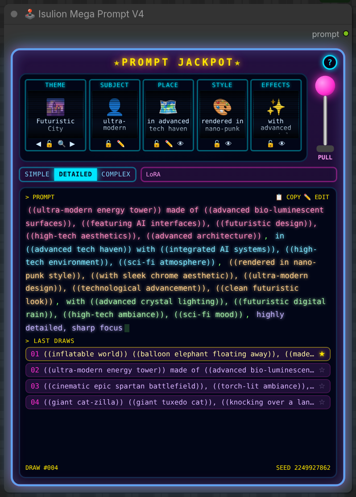

<p align="right"><b>English</b> · <a href="README.fr.md">Français</a></p>

# ComfyUI_Isulion

**Pull the lever, get a prompt.** A ComfyUI node pack built around the Mega Prompt generators: 109 hand-made themes, an arcade slot machine that writes your prompts, and a set of small generators and image tools to go with them.

<p align="center">
  
</p>

## Installation

**ComfyUI Manager (recommended):** open the **Custom Nodes Manager**, search for **Isulion** and install.

**Manual install:**

```bash
cd your_ComfyUI_install_dir/custom_nodes
git clone https://github.com/Isulion/ComfyUI_Isulion
```

Restart ComfyUI, then refresh the browser page. The only extra Python dependency is `requests` (see `requirements.txt`); everything else comes with ComfyUI.

--------------

## Interactive nodes

These two nodes draw their own interface inside the node (their frontend lives in `web/`).

### 🕹️ Isulion Mega Prompt V4 — "Prompt Jackpot"

A slot machine that writes your prompt. Five reels each draw one part of the prompt from the Isulion themes, and the node has a single output: `prompt`.

<p align="center">
  
</p>

**How to use it**

1. Add **🕹️ Isulion Mega Prompt V4** (category `Isulion/Core`) and connect `prompt` to your text encoder (e.g. `CLIPTextEncode`).
2. Pull the **PULL** lever to preview draws in the browser, without running the workflow.
3. Queue the workflow: the machine spins again on every run, and the screen shows exactly the prompt that was sent.

| Control | What it does |
|---|---|
| **Reels** | THEME (◀ ▶ to browse, 🔍 to search the 109 themes), SUBJECT, PLACE, STYLE, EFFECTS |
| 🔒 **Lock** | A locked reel never moves, neither with the lever nor when the workflow runs. Picking a theme locks it; leave it unlocked for a random theme each time. |
| ✏️ **Your own text** | On SUBJECT and PLACE: your text stays on every draw and the theme rebuilds the wording around it. ✕ clears it. |
| 👁 / 🚫 **On / off** | PLACE, STYLE and EFFECTS can be switched off: they turn grey and leave the prompt. |
| **SIMPLE / DETAILED / COMPLEX** | From no quality boilerplate, to a few detail words, to a richer block (composition, textures, lighting). |
| **LoRA** | Fixed text always added at the end, e.g. a trigger word or `<lora:name:0.8>`. |
| **PROMPT screen** | Each reel has its colour. Click a piece to re-draw only that reel. **COPY** copies the prompt; **EDIT** freezes a hand-written prompt, sent as-is on every run until you pull the lever again. |
| **Last draws** | The last 5 draws. Click one to load it back; ☆ keeps it as a favourite, on top of the list. The footer shows the draw counter and the seed. |
| **?** | Built-in help in English or French; the language you choose is remembered. |

The machine state (theme, locks, your texts, complexity, LoRA) is saved with the workflow. **Mega Prompt V3 is still available, unchanged**, for existing workflows.

### 👾 Isulion Space Invaders

A small Space Invaders game you play inside the node, for while the queue runs.

<p align="center">
  
</p>

- Click the game to give it focus, then **Enter** or **Space** to start (**Enter** to play again after a game over).
- **← →** or **A D** to move, **Space** to fire, **P** to pause. The game pauses when it loses focus and only reads the keyboard while it has focus, so ComfyUI shortcuts keep working.
- Outputs: `high_score` (INT), `last_score` (INT) and `summary` (STRING). Scores are saved with the workflow, so your best score can feed a seed or a prompt.

--------------

## Prompt generators

### 🚀 Isulion Mega Prompt V3

The classic generator: pick a theme and a complexity, and it builds a detailed prompt. Unlike V4, it also exposes each part on its own output (`prompt`, `subject`, `environment`, `style`, `effects`, `seed`).


[Source](https://civitai.com/user/Isulion/images?sort=Newest)

**Inputs**

- **Theme**: one of the 109 themes, or 🎲 Dynamic Random
- **Complexity**: simple, detailed or complex
- **Randomization**: enable or disable random generation
- **Custom subject / custom location**: force your own subject or place, and let the theme describe the rest
- **include environment / style / effects**: leave any part out of the prompt


**🔄 Isulion Multiple Prompt Generator** produces one prompt per theme in a single run: tick the themes you want (or use a selection mode) and it outputs a list of prompts with their theme names.

<details>
<summary><b>All 109 themes, by category</b></summary>

#### 1. Art Styles & Techniques
- 🎨 Abstract
- 🎨 Concept Art
- 🖍️ Crayon Art
- 🖼️ Digital Art
- 🔬 Experimental Art
- 🧊 Glassmorphism
- 🎨 Impressionist
- 🎈 Inflatable World
- 🧶 Knitted World
- 🧊 Liquid Chrome
- ⬜ Minimalist
- 🏺 Clay Art
- ✂️ Papercraft
- 🎨 Watercolor
- 🪩 Y2K Retro-Futurism

#### 2. Animation & Entertainment
- 📺 Animation Cartoon
- 🎌 Anime
- 🎬 Cinema Studio
- 📚 Comic Book
- 🎡 Disney
- 🎬 Dreamworks
- 🐱 Giant Cat-zilla
- 🍃 Ghibli
- 🎯 Logo
- 📺 Manga Panel
- 🦸 Marvel
- 🎬 Nolan Epic
- 👾 16-Bit Pixel Art
- 💫 Pixar
- 📚 School Manga
- 🎭 Stop Motion
- 🕹️ Voxel Low-Poly

#### 3. Science Fiction & Fantasy
- 🧬 Bio-Organic Technology
- 🪼 Bioluminescent Jelly
- 🌧️ Cinematic Neon Rain
- 💎 Crystalpunk
- 👟 Cyber Hypebeast
- 🌆 Cyberpunk
- ✨ Enchanted Fantasy
- ⚔️ Fantasy
- ⚔️ Futuristic Battlefield
- 🌆 Futuristic City
- 🌆 Futuristic City Metropolis
- 🚀 Futuristic Sci-Fi
- ⚔️ Miura Dark Fantasy
- 🍄 Psychedelic Cyber Fungus
- 🚀 Sci-Fi
- 🚀 Star Wars
- ⚙️ Steampunk
- 🌊 Underwater Civilization
- 🩻 X-Ray Anatomy

#### 4. Character Art
- 😄 Caricature
- 👤 Character Designer
- 🦄 Chimera Animals
- 🐰 Chimera Cute Animals

#### 5. Architectural & Spaces
- 🏛️ Architectural
- 🏠 Interior Spaces
- 🏙️ Urban Tag
- 🏠 Village World

#### 6. Dark & Horror
- 👻 Halloween Ethereal
- 👻 Horror
- ⚔️ Miura Dark Fantasy
- 📹 VHS Found Footage

#### 7. Holiday Themes
- 🏮 Chinese New Year
- 🎄 Christmas
- 👹 Dia de los Muertos
- 🐰 Easter
- 🎃 Halloween
- 👻 Halloween Ethereal
- 🎆 New Year's Eve
- 🍀 St. Patrick's Day
- 🦃 Thanksgiving
- 💘 Valentine's Day

#### 8. Nature & Environment
- 🌌 Astrophotography
- 🌿 Nature
- 🌿 Overgrown Ruins
- 🌊 Underwater Civilization

#### 9. Photography & Fashion
- 🎬 Analog 35mm Film
- 👗 Curvy Fashion
- 📸 Essential Realistic
- 📱 Fisheye Action Cam
- 📱 Instagram
- 📱 Instagram Lifestyle
- 📱 Selfie

#### 10. Food
- 🍳 Culinary/Food
- 🍕 Food Apocalypse
- 🥙 Street Food Kebab

#### 11. Vintage & Historical
- 🧺 50s Commercial
- 🪩 Disco Medieval
- 🕰️ Essential Vintage
- 🏛️ Historical Monuments
- 🕴️ Peaky Blinders
- 🛒 Retro Vaporwave Mall
- 👴 Vintage Anthropomorphic
- 📸 Vintage 1800s Photography

#### 12. Surreal & Dreams
- 🖼️ Binet Surreal
- 💠 Dimension 3D
- ✨ Ethereal Dreams
- 🌌 Glitch Core
- 🛋️ IKEA Backrooms
- 🔬 Microscopic
- 🧩 Puzzle Dimension
- 🦆 Rubber Duck Supremacy
- 💗 Spectral Mist
- 📦 Unboxing Surrealism

#### 13. Post-Apocalyptic
- 🌪️ Post Apocalyptic

#### 14. Random
- 🎲 Dynamic Random

#### Bonus Themes
- 🧸 Starter Pack
- 🚀 Space Colony
- 🏝️ Tropical Paradise
- 👧 Skinny Blonde Girl
- ⚔️ Medieval
- 🏛️ Spartan 300
</details>

Want to add your own theme? See the [Theme Creation Guide](Docs/Theme_Creation_Guide.md).

--------------

## All nodes

| Category | Nodes |
|---|---|
| **Interactive** | 🕹️ Isulion Mega Prompt V4 · 👾 Isulion Space Invaders |
| **Prompt generators** | 🚀 Isulion Mega Prompt V3 · 🔄 Isulion Multiple Prompt Generator · 🎥 Isulion Video Prompt Generator (camera angle, lighting, quality presets for video models) |
| **Animals** | 🦁 Animal Selector · 🐰 Cute Animal Selector · 🦊 Animal Behavior Generator (actions and poses) |
| **Scene** | 🌳 Habitat Generator · 🌤️ Weather Generator · 🌅 Time of Day Generator · 🖼️ Art Style Generator · ⚡ Action Generator · 🎬 Scene Composition (camera angles, shot types) |
| **Character** | 👨‍💼 Profession Generator · 🧝‍♂️ Fantasy Race Generator · 👔 Clothing Generator · ⏳ Epoch Generator (historical periods) |
| **Fantasy** | ✨ Magical Effect Generator · 🏰 Mythical Location Generator · ⚔️ Artifact Generator (magical items) |
| **Sci-Fi** | 🤖 Tech Generator · 👽 Alien World Generator · 🛸 Spacecraft Generator |
| **Enhancement** | 😊 Emotion Generator · 🎨 Style Mixer (blend several art styles) · 💫 Prompt Enhancer (details, mood, composition, lighting, colour) · ⛔ Negative Prompt Generator (adjustable strictness) |
| **Image** | 🖼️ Image Collage · 📁 Load Images from Directory · 🔒 Censored Part · ⧉ IsulionOverlay (overlays and watermarks) · 🧩 QRCode Generator · 🖼️ Display Image From URL |
| **Utilities** | 📝 Custom Text Node · 💾 Prompt Vault Save · 🗃️ Prompt Vault Load · 💤 Isulion Shutdown |
| **Civitai** | 🔍 Civitai Model Explorer · 🔥 Civitai Trending · 🖼️ Civitai Image Display |

In the node search, the full names start with "Isulion" (e.g. *Isulion Weather Generator*), except 📝 Custom Text Node.

### Notes on some nodes

- **📁 Load Images from Directory** loads every image of a folder as a batch. Folders are resolved strictly inside ComfyUI's `input` directory; absolute paths outside it are rejected.
- **🖼️ Image Collage** builds a collage from several input images, for collections or mood boards.
- **🔒 Censored Part** censors part of an image with blur, pixelate, pixelate + blur, black bar or noise. Pick the area with a painted mask (MaskEditor) or the built-in rectangle widgets; supports mask grow/shrink, invert and edge feathering, and outputs the censor mask for inpainting.
- **🖼️ Display Image From URL** downloads an image and shows it in the queue. URL download nodes only accept http(s) and refuse private or internal network addresses.
- **💤 Isulion Shutdown** shuts ComfyUI down when a workflow finishes. It does nothing unless the environment variable `ISULION_ENABLE_SHUTDOWN=1` is set.
- **🔍 Civitai Explorer / 🔥 Civitai Trending** authenticate with the `CIVITAI_API_TOKEN` environment variable; there is no API key widget, so tokens never end up in shared workflow files.

### 🗃️ Prompt Vault

A shared library of named prompt fragments, stored in ComfyUI's user directory (`ComfyUI/user/isulion/prompt_vault.json`) so your entries survive node updates. Until your first save, the example entries from `Core_Nodes/prompt_vault.example.json` are offered.

- **💾 Isulion Prompt Vault Save** stores the `text` widget (typed, or connected from any STRING node such as Mega Prompt) under `name`, and passes the text through unchanged so it can go straight on to your encoder. Saving an existing name updates it.
- **🗃️ Isulion Prompt Vault Load** picks a stored entry from a dropdown and outputs its text.

The vault path can be changed with the `ISULION_PROMPT_VAULT` environment variable. A missing or corrupt vault file gives an empty vault instead of breaking the queue.

> **Note:** the load node's dropdown is filled at page load, so newly saved entries appear after a browser refresh (Ctrl+Shift+R). Meanwhile you can type any entry name in the widget: it accepts free text, and the load node re-runs whenever the vault file changes.

--------------

## Example workflows

Drag a file from `example_workflows/` onto the ComfyUI canvas:

| Workflow | Contents |
|---|---|
| `Simple_Megaprompt_V4.workflow.json` | Mega Prompt V4 and Space Invaders. No other node pack needed. |
| `Simple_Megaprompt_V3.workflow.json` | Mega Prompt V3 and a text display. |
| `Full_Flux_Megaprompt_v3.workflow.json` | Mega Prompt V3 driving a full FLUX (GGUF) text-to-image pipeline. |
| `Multiple Mega Prompt.json` | Multiple Prompt Generator: one prompt per selected theme. |
| `Isulion_Civitai_Nodes_Workflow.json` | Civitai Trending and Civitai Image Display (set `CIVITAI_API_TOKEN`). |
| `All_Isulion_Nodes_Workflow.json` | A tour of most nodes of the pack. |

Except for the V4 one, these workflows use `ShowText|pysssss` from [ComfyUI-Custom-Scripts](https://github.com/pythongosssss/ComfyUI-Custom-Scripts) to display text. Install that pack, or replace those nodes with any text-display node. The FLUX workflow also needs the GGUF loader nodes and the FLUX models it references.

### Older FLUX examples

[More workflows and examples on Civitai](https://civitai.com/articles/8673/discover-the-mega-prompt-generator-for-comfyui)

**Basic MegaPrompt (old) workflow**


**Chimera (with Ollama) (old) workflow**


**MegaPrompt + Ollama + LoRA (old) workflow**


[LoRA used for this](https://civitai.com/models/673513/will-smith-flux-dev-lora)

The Ollama workflows need the Ollama_generator node in ComfyUI, with the environment variables `OLLAMA_KEEP_ALIVE=0` and `OLLAMA_ORIGINS=*`.

--------------

## Directory structure

```
ComfyUI_Isulion/
├── __init__.py               # node registration, version, WEB_DIRECTORY
├── Core_Nodes/
│   ├── mega_prompt_V3.py     # Mega Prompt V3
│   ├── mega_prompt_v4.py     # Mega Prompt V4 (machine state, roll, prompt assembly)
│   ├── mega_prompt_v4_routes.py  # /isulion/megaprompt_v4/* HTTP routes used by the lever
│   ├── mega_prompt_all_themes.py # Multiple Prompt Generator
│   ├── space_invaders_node.py
│   ├── theme_handlers/       # one handler per theme
│   ├── configs/              # theme word lists (JSON) and config manager
│   ├── animals_nodes/  character_nodes/  scene_nodes/
│   ├── fantasy_nodes/  scifi_nodes/  enhancement_nodes/
│   ├── civitai_nodes/
│   └── …                     # image and utility nodes (collage, load images, QR code, vault…)
├── web/                      # frontend of the interactive nodes
│   ├── mega_prompt_v4.js     # slot machine widget
│   ├── mega_prompt_v4_core.js  # pure helpers and EN/FR texts
│   └── space_invaders.js
├── example_workflows/
├── Docs/                     # Theme Creation Guide
├── assets/readme/            # README images
└── tests/                    # Python tests, tests/js for the V4 widget
```

## Development

```bash
python3 tests/run_all.py
```

Runs the whole suite without pytest (it works with pytest too). It also runs the JavaScript tests of the V4 widget, `node tests/js/test_mega_prompt_v4.mjs` (skipped when Node.js is not installed).

See [CHANGELOG.md](CHANGELOG.md) for the release history and breaking changes.
